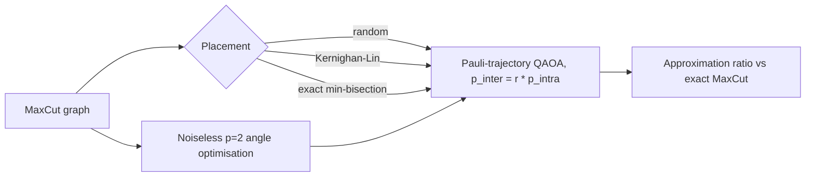
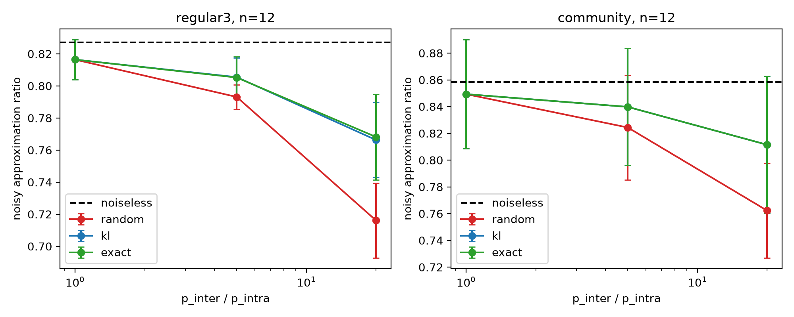
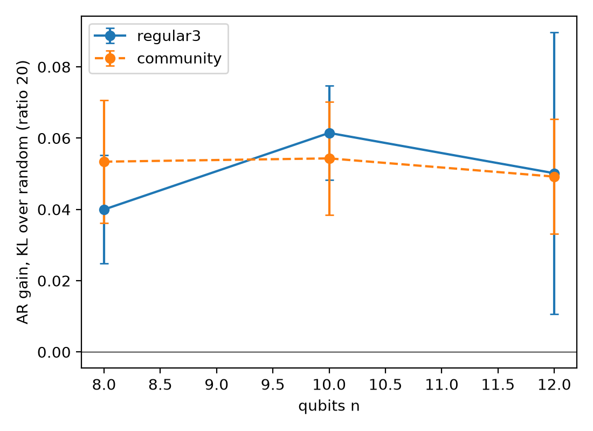

# modular-chip-aware-qaoa-placement

[](LICENSE)
[](pyproject.toml)
[](https://github.com/pradeepdegalaroyal/modular-chip-aware-qaoa-placement/actions)

**Abstract.** On modular quantum processors, chip-to-chip coupler gates are much noisier than intra-chip gates, and
QAOA's cost layer puts one two-qubit gate on every graph edge, so the vertex-to-chip assignment decides how many
noisy gates the circuit contains. This simulation study (n = 8-12 qubits, two chips, Pauli-trajectory noise)
measures how much MaxCut approximation ratio (AR) a chip-aware placement (Kernighan-Lin bisection) recovers compared with
a chip-oblivious random placement. At a 20x coupler/intra-chip error ratio it gains 0.04-0.06 AR on average
for both community-structured and 3-regular graphs, and it gains exactly nothing when the ratio is 1.

## Motivation and research gap
Hardware-aware compilers for coupler-connected modular systems are needed because monolithic compilers ignore the
fidelity asymmetry (Du et al., 2027, doi:10.1016/j.future.2026.108830). Error mitigation is costly and cannot fully
undo noise (Cai et al., 2023, doi:10.1103/RevModPhys.95.045005), and variational algorithms need reassessment as
hardware evolves (Wang et al., 2027, doi:10.15302/frontphys.2027.023301). The open question addressed here is
the *application-level* benefit for QAOA of a cheap chip-aware placement, as a function of the error ratio and graph
structure. Hypothesis, stated in advance (`docs/RESEARCH_GAP.md`): at ratio 20, KL raises AR by at least 0.02 over random
placement, and by exactly 0 at ratio 1.

## Method

Two chips of n/2 qubits; every cost-layer ZZ gate is followed by two-qubit depolarising noise, p_intra = 0.005 within a chip
and r x p_intra across a coupler (r = 1, 5, 20); 200 trajectories; mixers noiseless; coupler routing not modelled.
Angles are optimised noiselessly and shared by all placements, so differences come only from noise.
Baselines: random (chip-oblivious) placement with standard QAOA, the r = 1 uniform-noise case, and exact MaxCut as the
classical reference. Details: `docs/METHOD.md`.

## Results
Noisy AR at r = 20, mean ± std over 4 graphs (`results/summary.csv`); the last column is the mean number of coupler gates.

| graphs | n | random | KL | exact bisection | noiseless | coupler gates: random / KL |
|---|---|---|---|---|---|---|
| community | 8 | 0.794 ± 0.038 | 0.848 ± 0.027 | 0.848 ± 0.027 | 0.886 ± 0.020 | 6.0 / 1.75 |
| community | 10 | 0.744 ± 0.027 | 0.798 ± 0.040 | 0.798 ± 0.040 | 0.845 ± 0.030 | 10.75 / 3.0 |
| community | 12 | 0.762 ± 0.035 | 0.812 ± 0.051 | 0.812 ± 0.051 | 0.858 ± 0.040 | 16.0 / 5.25 |
| 3-regular | 8 | 0.750 ± 0.031 | 0.790 ± 0.025 | 0.789 ± 0.027 | 0.872 ± 0.022 | 7.0 / 4.0 |
| 3-regular | 10 | 0.737 ± 0.037 | 0.799 ± 0.031 | 0.801 ± 0.028 | 0.861 ± 0.025 | 9.0 / 3.5 |
| 3-regular | 12 | 0.716 ± 0.023 | 0.766 ± 0.023 | 0.768 ± 0.027 | 0.827 ± 0.015 | 9.5 / 4.5 |

Paired AR gain of KL over random (`results/gains.csv`, mean ± std over graphs):

| graphs | n | r = 1 | r = 5 | r = 20 |
|---|---|---|---|---|
| community | 8 | 0 | 0.015 ± 0.006 | 0.053 ± 0.017 |
| community | 10 | 0 | 0.015 ± 0.005 | 0.054 ± 0.016 |
| community | 12 | 0 | 0.015 ± 0.005 | 0.049 ± 0.016 |
| 3-regular | 8 | 0 | 0.009 ± 0.005 | 0.040 ± 0.015 |
| 3-regular | 10 | 0 | 0.018 ± 0.006 | 0.061 ± 0.013 |
| 3-regular | 12 | 0 | 0.012 ± 0.013 | 0.050 ± 0.040 |




## Discussion
- The hypothesis holds in this setting: at r = 20 the gain exceeds 0.02 for every family and size, and it is exactly 0 at r = 1 (control),
  so the gain comes from avoiding coupler gates, not from relabelling.
- At r = 5 the gain is small (0.009-0.018 AR) and below the 0.02 level I set for r = 20; the benefit becomes substantial only at large asymmetry.
- KL matches the exact minimum bisection on community graphs. On 3-regular graphs the mean difference is within 0.003 AR and changes sign
  (`gap_exact_kl_*` in `results/gains.csv`): minimum cut is a proxy for noise, and the difference is inside the spread.
- Chip-aware placement does not close the whole gap: for community graphs at n = 12, r = 20, KL reaches 0.812 versus 0.849 at r = 1 and 0.762 for random,
  i.e. it recovers about 57% of the loss attributable to the coupler asymmetry (derived from `results/summary.csv`).
- The 3-regular n = 12 gain has a large spread (±0.040 over 4 graphs). With four graphs per cell, differences between families or sizes are not statistically established.

## Limitations
Simulation only, n <= 12, two chips, all-to-all connectivity inside a chip; no SWAP routing, no idle/readout/mixer noise, no
crosstalk; a depolarising model rather than calibrated hardware noise; 4 graphs per cell and 200 trajectories (trajectory error
is not separately reported); p = 2 with noiselessly optimised angles (noise-aware retraining could change the picture). No quantum
advantage claim is made: the measured quantity is a placement effect inside one noisy-QAOA model.

## Future work
Add coupler-aware SWAP routing and calibrated per-edge error maps (e.g. `qiskit-aer` noise models and transpiler layout
comparison); more than two chips; noise-aware angle training; combining placement with zero-noise extrapolation, where
fewer coupler gates should also lower mitigation overhead; runs on a real modular device.
Related work by the author: [xy-mixer-vs-penalty-qaoa-noise-crossover](https://github.com/pradeepdegalaroyal/xy-mixer-vs-penalty-qaoa-noise-crossover)
(gate overhead vs feasibility under two-qubit noise) and [qml-rl-maxcut](https://github.com/pradeepdegalaroyal/qml-rl-maxcut).

## Reproducibility
```bash
pip install -r requirements.txt
python -m pytest -q tests
python experiments/run_all.py --quick   # smoke run (writes results_quick/, figures_quick/)
python experiments/run_all.py           # full run: 430 s (results/meta.json)
```
Run on Windows 11, Python 3.11.9, CPU only, with the versions pinned in `requirements.txt`.

## Project structure
```
src/modqaoa/core.py     simulator, noise, placements
experiments/run_all.py  all experiments + figures
tests/                  pytest
docs/                   RESEARCH_GAP.md, METHOD.md
results/  figures/      raw.csv, summary.csv, gains.csv, meta.json; PNGs
```

## Citation
See `CITATION.cff`. Degala Chenchupradeep (2026), *Chip-aware placement for QAOA on modular quantum devices*.

## License
MIT.
